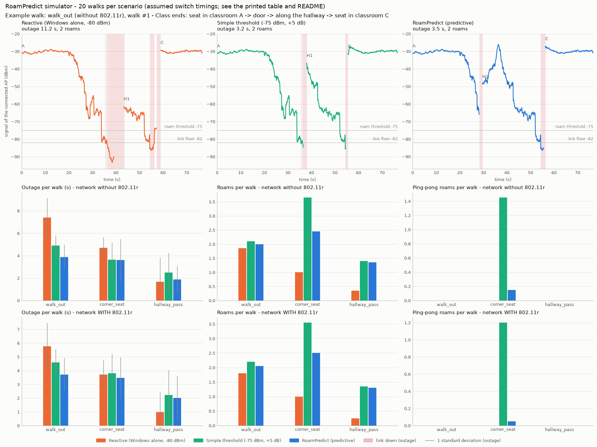

# RoamPredict

RoamPredict watches your Wi-Fi signal on a Windows 10/11 laptop, predicts that
you are about to lose your access point (for example when you walk out of a
classroom into the hallway) and asks Windows to switch to a better access point
of the same network **before** the connection drops.

It runs in **dry-run mode by default**: it only logs what it *would* do, and
checks those predictions against what Windows does on its own. Switching only
happens with `--active`, only on networks you allow-listed, and only after the
new access point has been checked on fresh scan data.

> ## Responsible use
>
> * Use RoamPredict **only on your own laptop and your own account**.
> * **Check your campus IT policy first.** Some institutions do not allow tools
>   that change how devices connect to their network. If in doubt, ask the IT
>   helpdesk.
> * **Never run it on other people's devices or accounts.**
> * RoamPredict never reads, asks for, logs or stores your user name, password
>   or certificates. It only passes the *name* of the Wi-Fi profile you already
>   saved in Windows. It sends no deauthentication frames, spoofs nothing and
>   injects no packets (the Windows API it uses cannot do those things anyway).

---

## Contents

1. [How it works](#how-it-works)
2. [Limits](#limits) - what Windows allows, and what this program cannot do
3. [Campus login (802.1X / eduroam)](#campus-login-8021x--eduroam)
4. [Install](#install-windows-powershell)
5. [Run the simulation](#run-the-simulation)
6. [Run on your laptop](#run-on-your-laptop)
7. [Lag under load (bufferbloat)](#lag-under-load-bufferbloat)
8. [Check the uncertain parts yourself](#check-the-uncertain-parts-yourself)
9. [Files and privacy](#files-and-privacy)
10. [Configuration](#configuration)
11. [Project layout and development](#project-layout-and-development)

---

## How it works

```
 RSSI 4x per second (WlanQueryInterface, dBm)
   -> ignore one-sample dips (median filter that needs 2 readings to accept a change)
   -> smooth (EMA, or Kalman)                  -> state machine
   -> slope in dBm/s (3 s least-squares window)    STABLE -> DEGRADING -> ROAM_IMMINENT
   -> "seconds until -75 dBm"                             -> ROAMING -> COOLDOWN
                                                        |
 BSS list (Windows' cache; a real scan at most every 6 s while degrading)
   -> rank candidates of the same SSID:  learned "usual next AP"
                                         + signal strength
                                         + how recently it was heard
                                         + "recently connected" (a cached key may make the switch fast)
   -> safe switch: fresh data, >= 8 dB stronger, allow-listed, not rate-limited, kill switch off
   -> WlanConnect(saved profile NAME, one desired BSSID)
   -> check the BSSID we ended up on, ping the gateway, ARP flush or DHCP renew
   -> measure every step and remember it (SQLite)
```

* **Hysteresis and dwell times**: DEGRADING starts below -67 dBm but ends only
  above -63 dBm; every change of state needs the condition to hold for 0.5 s
  (worse) or 2 s (better). A hand over the antenna does not change anything.
* **Minimum time between switches** (20 s, 60 s after a failure), a rate limit
  (6 per 10 minutes) and a "just left it" guard stop ping-pong.
* **Topology memory**: RoamPredict records which AP you actually *stay* on
  next (a 3-second detour does not count). If the AP you usually go to next
  is visible but not yet good enough, and the current link still has time,
  it waits for it instead of jumping to an AP you would leave again.
* **Windows' own roaming stays on all the time.** RoamPredict only adds
  requests. It never calls `WlanDisconnect`.

## Limits

Honest list of what Windows allows and what this program cannot do.

**Switching**

* **There is no public "roam now" command in Windows.** RoamPredict uses
  `WlanConnect` with your saved profile and one *desired* BSSID. This is a
  request, not an order: the driver may still pick another AP, and RoamPredict
  reports when it does.
* When you are already connected, Windows **most likely drops the link and
  connects again** instead of doing a quick in-place roam. So:
  * 802.11r Fast Transition probably does **not** speed up *this* switch
    (FT works inside an existing connection);
  * PMKSA caching can still help, if the AP still has your key.

  I could not confirm this for every driver. The log shows what Windows did:
  `disconnect_seen` and the event timeline of every switch.
* **Possible "pinning".** The older Windows driver documentation says a
  desired-BSSID list also restricts later roaming. So after a switch, Windows
  might keep you on that AP. While RoamPredict runs it handles later switches
  itself. When it exits, it prints a note if you are still on an AP it asked
  for. To release it, reconnect once: `netsh wlan connect name="eduroam"`.
* **On a network with 802.11r, Windows' own roaming may beat RoamPredict.**
  The simulator shows this (see below). Measure it on your campus with
  `roampredict report` before keeping active mode.

**Scanning**

* **Windows cannot scan a single channel.** `WlanScan` always scans all
  channels, and drivers may take up to 4 s. Scans take the radio off your
  channel for a moment, which causes lag spikes. So RoamPredict reads Windows'
  cached list most of the time. It requests a real scan at most every 6 s
  while the signal is degrading, and right before a switch only if the
  candidate was not heard in the last 3 s.
* **Windows 11 24H2 and newer** require Location permission for scan and BSSID
  data. Without it, those calls fail with "access denied"; `roampredict doctor`
  tells you.

**Authentication**

* **An app cannot pre-authenticate to the next AP.** Only 802.11r and PMKSA
  caching shorten the 802.1X login, and Windows and the driver handle both
  internally. (802.11i also defines "RSN pre-authentication". Windows profiles
  have a setting for it that is off by default. RoamPredict cannot trigger it;
  it only reports whether APs advertise it.)
* **Windows does not say whether a switch used 802.11r or a cached key.**
  RoamPredict infers it from the measured "authenticating -> connected" time.
* **No API announces a login prompt.** RoamPredict detects it indirectly (802.1X
  stuck for 6 s, or an 802.1X/security failure code). It then stops, trips the
  kill switch and leaves everything to Windows.

**Measuring and IP**

* **Python cannot flush the Wi-Fi driver's queue.** RoamPredict only resets its
  own sockets after a switch and *measures* latency idle vs under load.
* The driver may not support the dBm RSSI query (an Intel AX201 returned
  positive nonsense). Then RSSI is estimated from Windows' signal quality
  (quality / 2 - 100); trends still work. After every roam or reconnect that
  reading starts high (often exactly -50 dBm) and settles over about 6 s, so
  RoamPredict ignores the slope for 9 s after each one (`slope_warmup_s`);
  "already below the threshold" alarms still work during that time.
* **ARP flush needs admin. `ipconfig /renew` probably does too.** Without admin
  both are skipped and logged; everything else works as a normal user.

**Prediction**

* A slope cannot predict a sudden drop around a corner. Those are caught
  quickly by the level check, but not in advance.
* A step followed by a flat signal (for example a fire door) can look like a
  fast fall and cause a switch that was not needed.
* The ">= 8 dB stronger" rule prevents ping-pong, but in a corner where all APs
  are weak it keeps you on a weak AP longer. The simulator shows this too.
* 2.4 GHz access points always read stronger than 5 GHz ones (less path loss)
  but are slower and more crowded, so they count 7 dB weaker when choosing
  (`band_2g_penalty_db`). The 7 dB is the physics difference, not a
  measurement of your network.

**About this code**

* **Real hardware so far: one laptop (Intel AX201, Windows 10) on one campus
  network, in dry-run.** That found and fixed several problems (nonsense RSSI
  from the driver, blocked gateway ping, "scan already running", a crash on
  large error codes). Active switching has not run on real hardware yet. The
  Windows adapter is also tested against a stand-in for `wlanapi.dll` built
  from the same ctypes prototypes, and every structure's size and offsets are
  checked against the Windows x64 layout.
* **The simulator's switch times are assumptions, not measurements** (listed
  in `simulator/link_model.py` and printed with every result).

## Campus login (802.1X / eduroam)

* **The slow part of roaming** on WPA2/WPA3-Enterprise is the 802.1X/EAP
  exchange with the campus authentication (RADIUS) server: several round
  trips, sometimes forwarded through the eduroam federation. Only two real
  mechanisms shorten it:
  * **802.11r Fast Transition**, when the network enables it;
  * **PMKSA (key) caching**: returning to an AP whose key is still cached skips
    the EAP exchange.
* **"Recently connected" score.** Standard key caching is per AP (per BSSID). So
  RoamPredict stores every association time in SQLite and gives recently used
  APs a bonus. The bonus fades linearly and ends after
  `recent_assoc_ttl_hours` (default **12 h**).
  * **The 12 h default is a guess** that must be measured. It matches Windows'
    documented default profile `PMKCacheTTL` (720 minutes), but the APs or the
    RADIUS server may forget keys sooner.
* **Measure it.** Every switch is logged with total, association,
  authentication and IP times. It is tagged `recent`, `expired` or `never` (an
  AP never used before). `roampredict report` prints the medians per group:
  * `recent` clearly faster than `never`: caching works;
  * both equally slow: it doesn't, or the TTL is too long.
* **802.11r detection.** RoamPredict parses the raw information elements
  Windows returns for each AP:
  * an FT key-management suite in the RSN element, or a Mobility Domain
    element, means 802.11r is advertised;
  * 802.11k and 802.11v are detected the same way.

  `roampredict scan` and `roampredict doctor` show the result. If the driver
  returns no information elements, it says "unknown" (shown as `?`).
* **Credentials never leave Windows.**
  * RoamPredict only switches within the network you are already connected to
    (which proves Windows has working saved credentials).
  * It never reads profile XML (`WlanGetProfile`), never requests plaintext
    keys, and never reads 802.1X notification data (which can contain your
    user name).

## Install (Windows PowerShell)

```powershell
# 1. Python 3.11 or newer (or download it from python.org)
winget install -e --id Python.Python.3.12

# 2. Get the code
git clone https://github.com/farbachiadil05-arch/python-debana.git
cd python-debana
git checkout claude/upbeat-newton-gh5kgn

# 3. Virtual environment and install
py -3.12 -m venv .venv
.\.venv\Scripts\Activate.ps1
python -m pip install --upgrade pip
pip install -e ".[dev]"

# 4. Run the tests (about 10 s)
pytest
```

If `Activate.ps1` is blocked, run
`Set-ExecutionPolicy -Scope CurrentUser -ExecutionPolicy RemoteSigned` once, or
skip activation and call `.\.venv\Scripts\roampredict.exe` directly.

The runtime needs only the Python standard library. `matplotlib` (in `[dev]`
and `[sim]`) is only for the simulator plot.

Without installing, `python -m roampredict <command>` works from the project
folder. **After every `git pull`, check which copy runs:**
`python -m roampredict --version` prints the commit and the folder, for
example `roampredict 0.1.0 (code 4b8e73c in C:\...\python-debana)`. The
`run` start line and `doctor` show the same. With two clones on one laptop it
is easy to pull one and run the other.

## Run the simulation

No Wi-Fi hardware needed; this works on any OS.

```powershell
roampredict simulate --seeds 20 --plot sim.png
Invoke-Item sim.png
```

The simulated building is a school floor: seven classrooms, a hallway with a
fire door, masonry and concrete walls, and five 5 GHz APs. Signals use
log-distance path loss, wall attenuation, slow shadowing, reading noise, and
rare one-sample "hand over the antenna" dips.

Three routes:

* `walk_out`: from a seat in classroom A, along the hallway, to classroom C;
* `corner_seat`: 60 s in a corner of classroom E where three APs are all weak
  (-70 to -75 dBm);
* `hallway_pass`: the whole hallway without stopping.

Three strategies:

* **Reactive**: Windows alone, roaming at -80 dBm;
* **Simple threshold**: a raw reading below -75 dBm -> scan -> switch to the
  strongest AP if it is 5 dB better;
* **RoamPredict**: the real engine, running through the mock adapter.

The simulated Windows keeps doing its own roaming in all three.

Result of `--seeds 20` (mean per walk):

| route | 802.11r | strategy | outage (s) | roams | ping-pong | weak signal (s) |
|---|---|---|---|---|---|---|
| walk_out | no | Reactive (Windows, -80) | 7.40 ± 1.75 | 1.85 | 0.00 | 4.0 |
| | | Simple threshold (-75, +5 dB) | 4.89 ± 0.92 | 2.10 | 0.00 | 2.6 |
| | | **RoamPredict** | **3.87 ± 1.12** | 2.00 | 0.00 | 2.1 |
| walk_out | yes | Reactive (Windows, -80) | 5.76 ± 1.70 | 1.80 | 0.00 | 7.2 |
| | | Simple threshold | 4.59 ± 0.97 | 2.20 | 0.00 | 2.8 |
| | | **RoamPredict** | **3.71 ± 1.21** | 2.05 | 0.00 | 2.5 |
| corner_seat | no | Reactive | 4.71 ± 0.96 | 1.00 | 0.00 | 13.5 |
| | | Simple threshold | 3.64 ± 1.56 | 3.65 | **1.45** | 2.8 |
| | | **RoamPredict** | 3.60 ± 1.90 | 2.45 | **0.15** | 16.7 |
| corner_seat | yes | Reactive | 3.71 ± 1.03 | 1.00 | 0.00 | 13.5 |
| | | Simple threshold | 3.79 ± 1.41 | 3.55 | 1.20 | 2.2 |
| | | **RoamPredict** | 3.47 ± 1.50 | 2.50 | 0.05 | 13.4 |
| hallway_pass | no | Reactive | 1.66 ± 2.18 | 0.35 | 0.00 | 4.1 |
| | | Simple threshold | 2.48 ± 1.76 | 1.40 | 0.00 | 0.7 |
| | | **RoamPredict** | 1.87 ± 1.22 | 1.35 | 0.00 | 0.4 |
| hallway_pass | yes | Reactive | **0.98 ± 1.49** | 0.25 | 0.00 | 3.5 |
| | | Simple threshold | 2.23 ± 1.82 | 1.35 | 0.00 | 0.5 |
| | | RoamPredict | 2.00 ± 1.61 | 1.30 | 0.00 | 0.4 |

*Outage* = the link was unusable: switching, reconnecting, or below -82 dBm.
*Weak signal* = connected and usable, but below -75 dBm.



What it says, honestly:

* **Walking out of class** (a fast drop at the door and a corner): prediction
  roughly halves the outage compared with Windows alone. Windows' -80 dBm
  trigger reacts too slowly and sometimes loses the link completely.
* **In the weak corner** the naive rule ping-pongs (1.45 per walk) and
  RoamPredict almost never does. But RoamPredict's "+8 dB" rule keeps it on a
  weak AP longer (more *weak signal* time).
* **Walking a well-covered hallway on an 802.11r network, Windows alone
  wins**, because its own roams use Fast Transition. RoamPredict's
  disconnect/reconnect switches are assumed not to.
* The switch times are assumptions (full 802.1X 1.2 s, cached key 120 ms,
  802.11r 50 ms, ...). Replace them in `simulator/link_model.py` with the
  medians from `roampredict report` on your campus, and run it again.

## Run on your laptop

Use a normal PowerShell. Use "Run as administrator" only if you want the ARP
flush and DHCP renew steps.

```powershell
# 1. Can it work here? Fix anything marked FAIL (usually Location permission on Windows 11 24H2+).
roampredict doctor

# 2. What does your network advertise? (802.11r/k/v per AP)
roampredict scan --fresh

# 3. Create your config and allow-list your campus network
New-Item -ItemType Directory -Force "$env:LOCALAPPDATA\RoamPredict" | Out-Null
Copy-Item config.example.toml "$env:LOCALAPPDATA\RoamPredict\config.toml"
notepad "$env:LOCALAPPDATA\RoamPredict\config.toml"     # set allowed_ssids = ["eduroam"]

# 4. Dry-run for a few days while you walk around campus (Ctrl+C to stop).
#    --probe also times how long the internet was gone (pick a host that answers:
#    Test-NetConnection www.google.com -Port 443)
roampredict run --probe www.google.com

# 5. What happened? Windows' own roam times, dry-run prediction hits, learned paths
roampredict report

# 6. Only if dry-run looks good: really request switches
roampredict run --active

# 7. Compare again: recent vs never-used APs, RoamPredict vs Windows
roampredict report
```

**What the walk log tells you** (one terminal, one clock; example lines):

```
14:10:51 NET_DOWN    no answer from www.google.com:443 since 14:10:51.1
14:10:53 LINK_DOWN   Wi-Fi link lost at 14:10:51.3 - just before: -71.2 dBm (estimated), slope -0.4 dB/s,
                     state DEGRADING; last readings: -69 -70 -72 -71 -74 -77 -80 -83
14:10:57 WINDOWS_ROAM Windows roamed bc:..:30 -> bc:..:f0 (recent) after 6.2 s without Wi-Fi
14:10:58 NET_UP      internet answers again after 7.1 s (no answer since 14:10:51.1, 28 probes lost)
...
14:13:30 STOP        RoamPredict stopped (0/0 switches succeeded). This session: Wi-Fi link lost 3x,
                     73.4 s in total (longest 34.1 s); internet lost 3x, 78.0 s in total (longest 35.2 s)
```

* `LINK_DOWN` shows the signal just before the loss. If the link dies while
  the signal is still above the roam threshold, the access point (or driver)
  dropped you, which no signal-based prediction can foresee. If it was falling
  through the threshold, earlier action could have helped.
* The gap between the Wi-Fi link coming back and the internet answering again
  is 802.1X, DHCP and ARP.
* `Windows reported a failed connection attempt: ...` lines carry Windows' own
  explanation and the reason code.
* `IP_CHANGE` means the laptop got a new address, subnet or gateway, usually
  after a roam to a part of the campus with another subnet. Internet outages
  right before an `IP_CHANGE` are DHCP time.
* Every outage is stored. `roampredict report` sums them per mode: dry-run is
  Windows alone, active is RoamPredict switching. Walk the same route the same
  number of times in each mode, then compare.
* `roampredict report --timeline` lists the last outages and roams in time
  order, for example to see whether each internet outage came with a roam.
* With `--probe`, a dead internet connection is also a reason to move: on a
  campus walk the internet stopped answering 5 to 12 s before Windows declared
  the Wi-Fi link lost. While the probe gets no answers and the signal is at or
  below -65 dBm, RoamPredict treats it like "roam now" (state line: `internet
  stopped answering at ... dBm`). The usual rules still apply: a candidate at
  least 8 dB stronger, fresh scan, allow-list, rate limit. Turn it off with
  `probe_trigger = false` under `[roam]`.
* While the internet is dead, the signal reading on some laptops freezes at
  its last value. "8 dB stronger" is then measured against what the last scan
  saw for your current AP, or against -85 dBm if the scan did not hear it at
  all. The `DECISION` line says when this happened.
* `NO_CANDIDATE` lines say why RoamPredict wants to switch but does not: the
  best AP and what it lacks (e.g. "only +6.0 dB vs current").

**Emergency stop** from any other window: `roampredict kill`. A running
RoamPredict stops switching within a quarter of a second. `roampredict unkill`
allows switching again. The kill switch also trips by itself after 2 failed
switches in a row, or when a login prompt is suspected.

**What to decide from the report:**

* Keep `--active` only if RoamPredict's switches are shorter or less disruptive
  than Windows' own roams on your campus.
* Otherwise keep it in dry-run as an advisor, or instead try your driver's
  "Roaming Aggressiveness" setting, which `doctor` shows. It is the official
  setting for roaming earlier and works with 802.11r.

Useful extras: `roampredict run --verbose` prints every sample;
`roampredict paths` shows where files live; `roampredict forget --yes` deletes
what it learned.

## Lag under load (bufferbloat)

```powershell
roampredict latency                                   # ping the Wi-Fi gateway for 10 s (ICMP)
roampredict latency --url https://example.org/big.iso # 10 s idle, then 10 s while downloading
roampredict latency --target www.google.com --tcp-port 443   # if the campus blocks ICMP
```

Some campuses also block public DNS servers such as `1.1.1.1`, so check the
target first: `Test-NetConnection www.google.com -Port 443` must say
`TcpTestSucceeded : True`. The host name is looked up once, so DNS delays
are not counted. Outages (2+ unanswered probes in a row) are listed with
clock times, which you can line up with the `run` log.

Use a large file you are allowed to download (for example from your campus
software mirror). Compare the numbers before and after a switch, or at
different spots. RoamPredict cannot remove the queueing delay; it can only
measure it.

## Check the uncertain parts yourself

| Question | How to check |
|---|---|
| Does `WlanConnect` drop the link first on your laptop? | RoamPredict's log: `detail.disconnect_seen` and `detail.events` of every switch. Or, in an admin PowerShell: `netsh wlan show wlanreport`, then open `C:\ProgramData\Microsoft\Windows\WlanReport\wlan-report-latest.html` |
| Does Windows stay "pinned" after a switch? | Stop RoamPredict after an active switch and walk away. If Windows never roams, reconnect: `netsh wlan connect name="eduroam"` |
| What does a Windows reason code mean? | RoamPredict prints Windows' own text (`WlanReasonCodeToString`) next to the code. For a history of every connect/disconnect with reasons: `netsh wlan show wlanreport` in an admin PowerShell. That report may include your login name, so read it yourself rather than sharing it |
| Does `ipconfig /renew` need admin? | Run `ipconfig /renew "Wi-Fi"` in a normal PowerShell |
| ARP flush command options | `netsh interface ip delete arpcache /?` (RoamPredict uses `FlushIpNetTable2` for the Wi-Fi interface and falls back to this command) |
| Does netsh show 802.11r? | `netsh wlan show networks mode=bssid`. I don't think most builds show it; `roampredict scan` parses it from the information elements instead |
| The driver's roaming setting | `Get-NetAdapterAdvancedProperty -Name "Wi-Fi" \| Format-Table DisplayName, DisplayValue, RegistryKeyword` |
| Location permission | Settings > Privacy & security > Location: "Location services" and "Let desktop apps access your location" |
| Windows' key cache time (optional) | `netsh wlan export profile name="eduroam" folder=$env:TEMP`, look for `PMKCacheTTL` in the XML, then delete the file. The export contains your EAP settings. As far as I know it contains no password for 802.1X profiles, but check before sharing it. RoamPredict itself never does this. |

## Files and privacy

Everything stays on your laptop in `%LOCALAPPDATA%\RoamPredict\`:

* `config.toml`: your settings; there is no place for credentials.
* `roampredict.db`: AP addresses, signal levels, association times,
  transitions and switch timings.
* `logs\roampredict.jsonl`: one JSON line per event (decisions with score
  breakdowns, switch timings).
* `KILL`: present = switching stopped.

AP addresses together with times show where you have been, so treat the
database like location history. `roampredict forget --yes` clears it; deleting
the folder removes everything. Nothing is sent anywhere. The only exception is
the download you start yourself with `roampredict latency --url`.

## Configuration

See [`config.example.toml`](config.example.toml). Every key has a comment.
Unknown keys are errors, so typos cannot silently fall back to defaults. The
important ones:

* `safety.allowed_ssids`
* `thresholds.roam_threshold_dbm` (-75)
* `roam.min_gain_db` (8)
* `roam.cooldown_s` (20)
* `ranking.recent_assoc_ttl_hours` (12, a guess)

## Project layout and development

```
roampredict/
  config.py            TOML config -> component settings (validated)
  validate.py          BSSID / SSID / profile-name validation
  signal/filter.py     spike rejection, EMA, Kalman
  signal/trend.py      sliding-window regression, time-to-threshold
  state_machine.py     STABLE -> DEGRADING -> ROAM_IMMINENT -> ROAMING -> COOLDOWN
  topology/store.py    SQLite memory
  topology/predictor.py candidate ranking with score breakdown
  platform/base.py     adapter interfaces and data types
  platform/windows_wlan.py   wlanapi.dll via ctypes
  platform/win32_structs.py  ctypes structures (layout-tested)
  platform/info_elements.py  802.11r/k/v detection from beacons
  platform/mock.py     fake adapter for tests and the simulator
  roam/executor.py     safe switch
  net/l3.py            gateway, ping, ARP flush, DHCP renew (iphlpapi)
  net/latency.py       latency under load, own-socket reset
  safety.py            dry-run, allow-list, kill switch, rate limit
  engine.py            the control loop
  telemetry.py         JSON-lines log
  doctor.py            roampredict doctor
  cli.py               commands
simulator/             floor plan, radio model, walker, switch costs, strategies, runner, plot
tests/                 pytest (runs on any OS)
```

`roampredict/signal` and `roampredict/platform` share their names with
Python's own `signal` and `platform` modules. That is fine as long as you
start RoamPredict with `roampredict ...` or `python -m roampredict ...`, and
never with `python roampredict\cli.py`.

```powershell
pytest                                  # all tests
python -m simulator.run --seeds 5       # quick simulation
```
